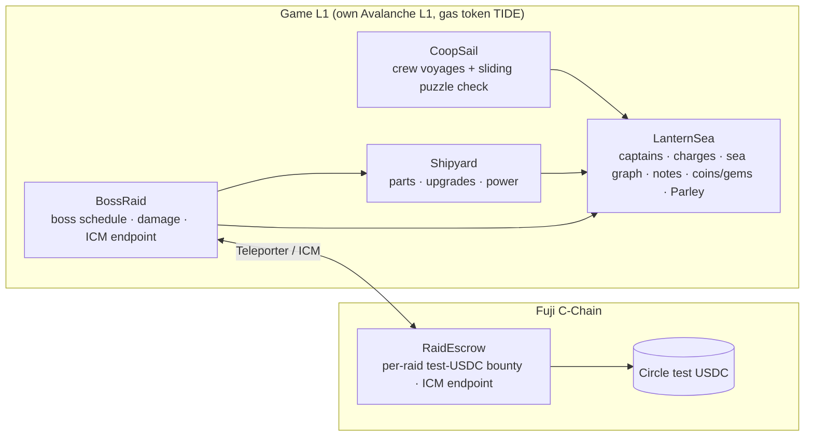

# Architecture and game rules

[← README](../README.md)

## Two chains, one message bus

Frequent game actions (sailing, notes, puzzles, attacks, Parley) happen on the **Game L1**, where gas is a free native token. **Money stays on C-Chain.** ICM carries only messages:

| Message | Direction | When | Effect |
| --- | --- | --- | --- |
| `RAID_OPENED` | L1 → C-Chain | Partner accepts the raid lead | Escrow registers the raid, its two funders and its deadline |
| `BOUNTY_FUNDED` | C-Chain → L1 | A lead captain escrows USDC | L1 shows the bounty to helpers |
| `RAID_SETTLED` | L1 → C-Chain | Anyone settles a finished raid | Escrow credits helpers by damage share and refunds the rest |

Both endpoints check the messenger, the source blockchain ID and the peer contract. Peers can be bound only once, and nobody has an admin path to move funds.

## Contracts

| File | Chain | Role |
| --- | --- | --- |
| `src/game/LanternSea.sol` | L1 | Core: registration, charges, hashed sea graph, island claims, captain's log, coins/gems, Parley signatures. Modules are wired once with `setModules`. |
| `src/game/CoopSail.sol` | L1 | Crew voyages: propose → join (both pay charges) → both submit puzzle moves within the window. The contract replays the moves. |
| `src/game/Shipyard.sol` | L1 | A fixed catalogue of 15 parts in 5 slots, plus damage and multiplier upgrades paid in coins. |
| `src/game/BossRaid.sol` | L1 | Boss per epoch, lead-crew proposal/accept, attacks, settlement, ICM sender/receiver. |
| `src/escrow/RaidEscrow.sol` | C-Chain | Per-raid bounty from the two lead captains, pull-based claims, timeout refund. |
| `src/lib/SlidePuzzle.sol` | — | 4×4 board in a `uint64`, deterministic scramble, move replay. |
| `src/lib/SeaMessages.sol` | — | ICM message kinds. |
| `src/mocks/*` | local only | `MockTeleporter` (no Warp security) and `MockUSDC` (local test token). Never deploy these publicly. |

## Rules in numbers

| Rule | Normal | Demo (`DEMO_MODE=true`) |
| --- | --- | --- |
| Sailing charges | max 3, +1 every 160 min (full in 8 h) | +1 per minute |
| Streak "day" | 24 h | 5 min |
| Parley length | 1 h, once per pair per day | 10 min |
| Crew puzzle window | 60 s | 60 s |
| Boss epoch | 1 day | 10 min |
| Escrow refund grace | 3 days after the raid deadline | 10 min |

The demo flag is fixed when the contracts are deployed. There is no admin clock.

**Sea graph.** Island IDs run from 0 to `mapSize - 1` (256 in the demo, drawn as a 16×16 grid):
- Lane count = `1 + keccak(seed, island, "lanes") % 4`.
- Lane `d` goes to `keccak(seed, island, d) % mapSize`, so destinations collide on purpose.
- Lane cost is 1 (60%), 2 (30%) or crew 4–5 (10%).
- Home = `keccak(seed, captain) % mapSize`.
- The browser recomputes the same hashes in `web/src/world.js`, and the e2e test checks it against the contract.

**Rewards (deterministic):**

| Landing | Coins | Extra |
| --- | --- | --- |
| ⚓1 lane | 10–20 | |
| ⚓2 lane | 25–40 | |
| Crew lane | 60–100 | One gem for each captain |

- On solo lanes, the position inside the range is `min(streak, 5) / 5`. On crew lanes it is puzzle speed: the slower captain's time against the 60-second window.
- An island that is already claimed pays nothing, but you can still visit it, read and sign its log, and sail its lanes.

**Island interior and note poles.** Tapping an island on the map takes you ashore:
- The interior is a 9×9 tile grid. `LanternSea.isLand(island, tile)` decides which tiles are land, using 8 radial sectors with hash-chosen radii. The 3×3 centre is always land, and `web/src/world.js` mirrors the check exactly (the e2e test compares them).
- Each island has a hash-chosen theme (Tropical, Jungle, Volcanic or Crystal) with matching scenery: swaying palms, crabs, shells, campfires, a smoking volcano or sparkling crystals, gulls and drifting clouds. The theme and scenery are cosmetic only.
- Sailing or a Parley jump plays a voyage on the sea map: the ship follows the lane with a wake, the camera follows it, the new island pops out of the fog, and then you go ashore. If the page is in the background, the voyage finishes instantly.
- Each sea lane shows as a dock on the shore, pointing the way it sails.
- A note is a **pole** that costs `NOTE_COST` = 25 coins, which are in-game points, never money. The first pole on an island must stand on the centre tile (40). Every later pole goes on a free land tile the captain picks. Each captain can build one pole per island, and the contract checks the tile is land and free.
- The hash decides only geography. Rewards never come from the hash.

**Coins and gems** are internal counters, not tokens:
- Coins buy ship parts and upgrades.
- Gems sell to the harbour for fixed coin prices: Pearl 50, Emerald 80, Sapphire 120, Ruby 200.
- Nothing converts to money.

**Ship power:**
- Power = damage × mult × (product of the × parts).
- A lead crew attacks with combined power: (dmgA + dmgB) × (multA + multB) × xA × xB.
- Base power is 10 for one ship and 40 for a crew.

**Bosses:** the island is `keccak(seed, "boss", epoch)`, and HP cycles 1500 / 2500 / 4000 / 6000. The lead crew earns HP ÷ 5 coins when the boss falls.

## Money flow (raid bounty)

1. Two captains form the lead crew on L1. `RAID_OPENED` reaches the escrow.
2. Each lead captain may `fund` the escrow with test USDC, up to 100 per raid. `BOUNTY_FUNDED` updates L1.
3. Helpers attack, spending 1 charge per attack. Damage is recorded per address, with up to 20 helpers.
4. Anyone calls `settle` when the boss falls or the epoch ends. `RAID_SETTLED` reaches the escrow:
   - **Boss defeated:** each helper gets `bounty × helperDamage / totalDamage`. The rest goes back to the two funders in proportion to what each put in.
   - **Boss survived:** both funders get a full refund.
5. Payouts are credited, and each person calls `claim()`. If no settle message arrives, `refundExpired` returns deposits after the grace period.

Accounting invariant, checked in tests: `USDC.balanceOf(escrow) == totalEscrowed + totalClaimable`.

## Known limits (state these honestly)

- **Parley proximity:** the QR proves the code is at most 2 minutes old, not that the phones are in the same place. A screenshot sent remotely works. Bluetooth/NFC or location checks would be next.
- **Puzzle:** the scramble comes from public on-chain data, so a bot can compute a solution. The puzzle proves that two captains coordinated within the time window, not that they solved it by hand.
- **Escrow:** each raid's escrow holds money from two people, the lead crew. Confirm with the organizers that this per-raid escrow is acceptable under the "pooled funds behind a multisig" rule. The escrow has no admin keys and always refunds.
- **Not audited.** Test tokens only. Event history is read with `getLogs` from block 0, which may need an indexer on a long-lived chain.
